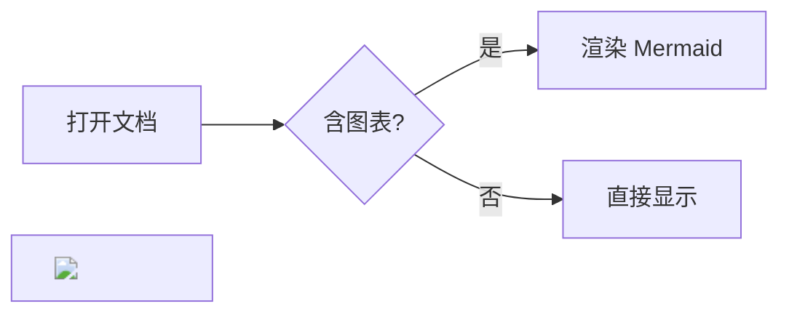
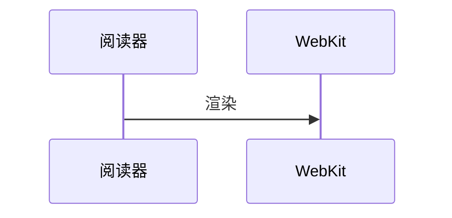
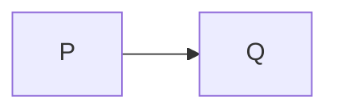
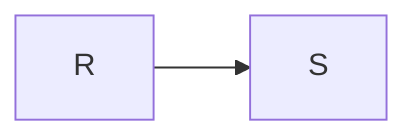
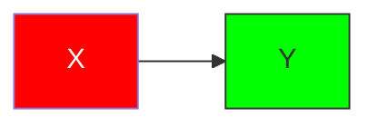

# 阅读测试

## 表格与代码

| 名称 | 内容 |
| --- | --- |
| 本地 | 中文阅读 |

```swift
let title = "Hello"
print(title)
```


<script>window.injected = true</script>


[跳到章节](#表格与代码)

- [x] 已完成
- [ ] 待完成

行内公式 $E=mc^2$，价格 $5 和 $10 不是公式，转义 \$x\$ 也不是。

$$
\int_0^1 x^2\,dx = \frac{1}{3}
$$

```math
\sum_{n=1}^{\infty} \frac{1}{n^2} = \frac{\pi^2}{6}
```

$\href{javascript:alert(1)}{点我}$

$\htmlStyle{position:fixed;top:0}{x}$ $\htmlClass{evil}{y}$ $\htmlId{readerReady}{z}$ $\url{javascript:alert(1)}$ $\includegraphics{local.png}$





```mermaid
这不是合法的图表
```






